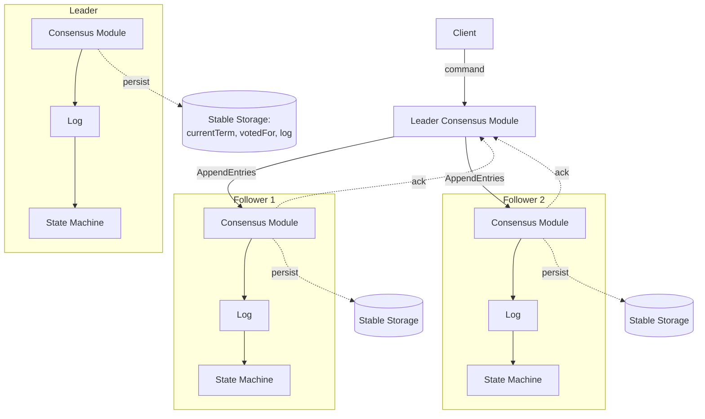
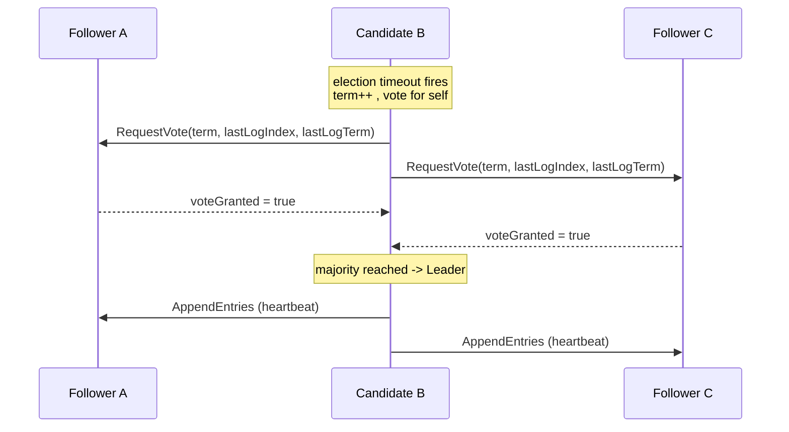
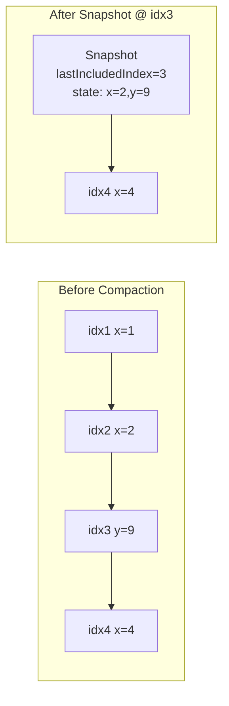

# Raft Deep Dive

## Architecture

A Raft cluster is a set of servers (typically 3 or 5) that cooperate to maintain a single replicated log. One server is the leader; the rest are followers. Clients send commands to the leader, which appends them to its log, replicates them to followers, and — once a majority has stored an entry — commits it and applies it to the local state machine. Every server contains the same set of components: a consensus module that runs the Raft protocol, a log, and a state machine that consumes committed entries.

## Key Internals

### Server States & Terms

Each Raft server is always in one of three states:

- **Follower**: Purely passive. It issues no requests on its own; it only responds to RequestVote and AppendEntries RPCs. If it receives no communication over an election timeout, it converts to a candidate.
- **Candidate**: Used to elect a new leader. It votes for itself and solicits votes from peers.
- **Leader**: Handles all client requests and drives log replication. There is at most one leader per term.

**Terms** are the algorithm's logical clock. Each term is a monotonically increasing integer beginning with an election. Every RPC carries the sender's term. The rule is universal: **if a server sees a term greater than its own, it updates `currentTerm` and reverts to follower; if it sees a smaller term, it rejects the request.** This single rule neutralizes stale leaders and out-of-date candidates automatically.

### Leader Election

Followers expect periodic heartbeats (empty AppendEntries) from the leader. Each follower runs an **election timeout** chosen randomly from a range (e.g., 150–300 ms). When the timer fires without a heartbeat:

1. The server increments `currentTerm` and transitions to **candidate**.
2. It votes for itself and records `votedFor`.
3. It resets its election timer and sends **RequestVote** RPCs to all other servers in parallel.

Three outcomes are possible:

- **Wins**: It receives votes from a majority (including its own) and becomes leader, immediately sending heartbeats.
- **Loses**: It receives an AppendEntries from a legitimate leader (equal or higher term) and steps down to follower.
- **Split vote**: No candidate wins. Each candidate times out and starts a new election with a higher term. **Randomized timeouts** make it likely that one candidate times out first, keeping split votes rare.

A server grants its vote only if: (a) it has not already voted in this term (`votedFor` is null or equals the candidate), and (b) the candidate's log is **at least as up-to-date** as its own (see Election Restriction below).

### Log Structure & Log Replication

The log is an array of **entries**, each holding a state-machine command and the **term** in which the leader created it. Entries are identified by their **index** (position in the log). Once elected, the leader:

1. Appends a client command to its own log as a new entry.
2. Sends **AppendEntries** RPCs (in parallel) to all followers containing the new entries.
3. Each AppendEntries includes `prevLogIndex` and `prevLogTerm` — the index/term of the entry immediately preceding the new ones.
4. A follower accepts the entries only if its log contains a matching entry at `prevLogIndex` with `prevLogTerm`. Otherwise it rejects, and the leader **decrements `nextIndex`** for that follower and retries, walking backward until the logs agree, then overwriting any conflicting suffix.

This produces the **Log Matching Property**:
- If two entries in different logs have the same index and term, they store the same command.
- If two entries have the same index and term, then all preceding entries are identical.

The leader maintains two pieces of per-follower bookkeeping: `nextIndex[]` (the next entry to send) and `matchIndex[]` (the highest entry known replicated).

### Commitment & Applying Entries

An entry is **committed** when the leader that created it has replicated it on a **majority** of servers. The leader finds the highest index `N` such that `matchIndex >= N` on a majority **and** `log[N].term == currentTerm`, and sets `commitIndex = N`. It then applies entries up to `commitIndex` to its state machine and returns results to clients. The `commitIndex` is piggybacked on subsequent AppendEntries so followers advance their own `commitIndex` and apply the same entries in the same order.

**Critical subtlety:** a leader may only directly commit entries **from its own term**. It must never conclude that an entry from a *previous* term is committed merely because it sits on a majority — doing so can be unsafe (Figure 8 in the paper). Older entries become committed indirectly, once an entry from the current term is committed on top of them.

### Safety Guarantees

Raft guarantees five properties that together ensure the replicated state machines never diverge:

| Property | Guarantee |
|----------|-----------|
| **Election Safety** | At most one leader can be elected in a given term. |
| **Leader Append-Only** | A leader never overwrites or deletes entries in its own log; it only appends. |
| **Log Matching** | If two logs contain an entry with the same index and term, the logs are identical up to that index. |
| **Leader Completeness** | If an entry is committed in a term, it is present in the logs of all leaders of higher terms. |
| **State Machine Safety** | If a server has applied an entry at a given index, no other server will ever apply a different entry for that index. |

The keystone is the **Election Restriction**: a candidate cannot win unless its log is at least as up-to-date as a majority. "Up-to-date" is defined by comparing the last entries' terms; if terms differ, the higher term wins; if equal, the longer log wins. This ensures the winning leader already holds all committed entries, which in turn provides Leader Completeness and State Machine Safety.

### Persistence & Recovery

Before a server responds to any RPC, it must persist three pieces of state to **stable storage** (disk):

- `currentTerm` — the latest term the server has seen.
- `votedFor` — the candidate it voted for in the current term (or null).
- `log[]` — the log entries.

`commitIndex` and `lastApplied` are volatile and safely reconstructed after a restart. Persisting `currentTerm`/`votedFor` prevents a restarted server from voting twice in the same term; persisting the log prevents loss of committed data. On restart a server comes up as a follower, loads its persisted state, and rejoins the cluster; the leader's AppendEntries consistency check brings any lagging log back into agreement.

### Log Compaction & Snapshots

A log that grows forever wastes space and makes restarts slow. **Snapshotting** is Raft's compaction mechanism: each server independently writes a snapshot of its state machine up to some index, recording `lastIncludedIndex` and `lastIncludedTerm`, then discards all log entries through that index.

When a follower lags so far behind that the leader has already discarded the entries it needs, the leader sends an **InstallSnapshot** RPC transferring the snapshot directly. The follower installs it, discards any conflicting prefix, and resumes normal replication from the snapshot's boundary.

### Cluster Membership Changes

Changing the set of servers is dangerous because you cannot switch every server atomically — during the transition two disjoint majorities could form and elect two leaders. Raft solves this with **joint consensus**, a two-phase approach:

1. The leader appends a **joint configuration** entry (C-old,new) to the log. While it is in effect, agreement (for elections and commitment) requires separate majorities from **both** the old and the new configurations. This overlap makes two independent leaders impossible.
2. Once C-old,new is committed, the leader appends a **new configuration** entry (C-new). Once C-new commits, the transition is complete and servers no longer in C-new can shut down.

Configuration changes take effect the moment an entry is **appended** (not when committed), and a server always uses the latest configuration in its log. Many production systems (e.g., etcd, HashiCorp Raft) instead use the simpler **single-server change** approach — adding or removing one server at a time — which avoids joint consensus while preserving majority overlap. **Learner/non-voting** members are often added first so a new server can catch up its log before it counts toward quorum.

## Resources

### Official Documentation
- [The Raft Consensus Algorithm (raft.github.io)](https://raft.github.io/) — Official Raft site with the paper, visualizations, and a curated list of implementations
- [In Search of an Understandable Consensus Algorithm (Extended Version)](https://raft.github.io/raft.pdf) — The definitive Raft paper by Diego Ongaro and John Ousterhout (2014); Figure 2 is the complete protocol spec
- [Consensus: Bridging Theory and Practice](https://github.com/ongardie/dissertation) — Diego Ongaro's PhD dissertation with full treatment of membership changes, snapshots, and client interaction

### Articles
- [Raft (algorithm) — Wikipedia](https://en.wikipedia.org/wiki/Raft_(algorithm)) — Solid conceptual summary of states, terms, and safety
- [Students' Guide to Raft (MIT 6.824)](https://thesecretlivesofdata.com/raft/) — The Secret Lives of Data: an animated, step-by-step walkthrough of election and replication
- [Instructors' & Students' Guide to Raft — Jon Gjengset](https://thesquareplanet.com/blog/students-guide-to-raft/) — Hard-won practical advice on the subtle bugs when implementing Raft (2016)
- [A deep dive into Apache Kafka's KRaft protocol](https://developers.redhat.com/articles/2025/09/17/deep-dive-apache-kafkas-kraft-protocol) — How Raft is applied in Kafka to replace ZooKeeper (Red Hat, 2025)

### Videos
- [Raft Lecture — John Ousterhout (Stanford)](https://www.youtube.com/watch?v=vYp4LYbnnW8) — The co-author explains the algorithm and its design rationale
- [Designing for Understandability: The Raft Consensus Algorithm](https://www.youtube.com/watch?v=vYp4LYbnnW8) — Ousterhout's talk on why understandability was the primary design goal

### Interactive
- [Raft Visualization (raft.github.io/#implementations)](https://raft.github.io/) — In-browser interactive Raft where you can trigger elections and partitions
- [The Secret Lives of Data — Raft](https://thesecretlivesofdata.com/raft/) — Guided animation of the whole protocol

### Source Code
- [etcd-io/raft](https://github.com/etcd-io/raft) — The Raft library behind etcd/Kubernetes; a canonical, production-grade Go implementation
- [hashicorp/raft](https://github.com/hashicorp/raft) — Consul's Raft library, with clear docs on single-server membership changes
- [tikv/raft-rs](https://github.com/tikv/raft-rs) — Rust port of the etcd Raft implementation used by TiKV
