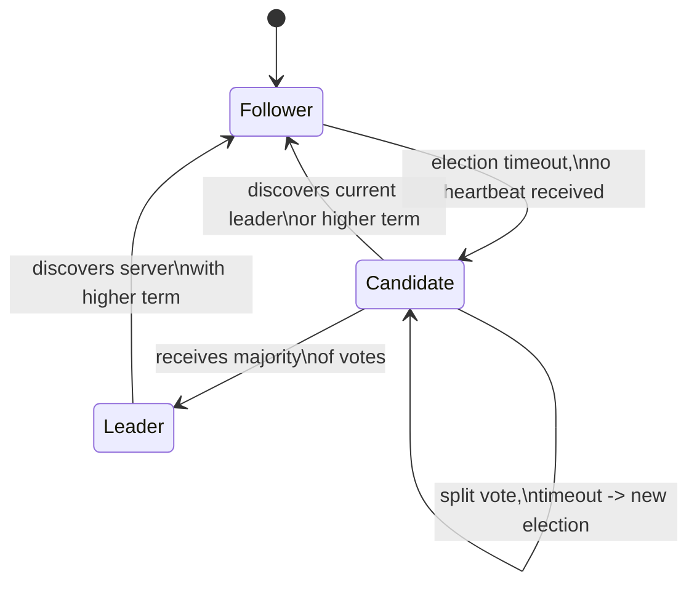

# Raft Overview

## What is Raft?

Raft is a consensus algorithm for managing a replicated log across a cluster of servers. It was designed by Diego Ongaro and John Ousterhout at Stanford (published in 2014 in the paper *"In Search of an Understandable Consensus Algorithm"*) with an explicit goal: be **easier to understand** than Paxos while providing the same fault-tolerance and performance guarantees. Raft powers the backbone of many production systems — etcd (Kubernetes), Consul, TiKV, CockroachDB, and Kafka's KRaft mode. It solves the problem of getting a group of machines to agree on a sequence of state changes even when some of them fail, so that the cluster behaves like a single, reliable state machine.

## Core Concepts

- **Replicated State Machine**: Each server runs an identical deterministic state machine. If every server applies the same commands in the same order, every server reaches the same state. Raft's job is to keep the command **log** identical across servers.
- **Leader-Based**: At any time exactly one server is the **leader**; all others are **followers**. Clients talk only to the leader. This asymmetry is what makes Raft simpler than Paxos — the leader is the single source of truth for the log.
- **Terms**: Time is divided into **terms**, numbered monotonically. Each term begins with an election. Terms act as a logical clock that lets servers detect stale leaders and obsolete information.
- **Server States**: Every server is in one of three states — **Follower** (passive, responds to leaders/candidates), **Candidate** (trying to become leader), or **Leader** (handles all client requests).
- **Log & Commit**: The log is an ordered sequence of **entries**, each tagged with the term in which it was created. An entry is **committed** once it is safely replicated on a majority of servers; committed entries are then **applied** to the state machine.
- **Two RPCs**: The entire protocol runs on just two RPCs — **RequestVote** (used during elections) and **AppendEntries** (used to replicate log entries and as a heartbeat). A third, **InstallSnapshot**, is added for log compaction.
- **Majority Quorums**: Every decision (electing a leader, committing an entry) requires agreement from a **majority** of the cluster. A 5-node cluster tolerates 2 failures; a 3-node cluster tolerates 1.

## How It Works (High Level)

A Raft cluster elects a leader using randomized timeouts. Each follower waits a random **election timeout**; if it hears no heartbeat from a leader in that window, it increments its term, becomes a **candidate**, votes for itself, and sends **RequestVote** RPCs to the others. A server grants its vote if the candidate's log is at least as up-to-date as its own and it hasn't already voted this term. A candidate that collects votes from a majority becomes leader and immediately starts sending heartbeats to suppress further elections. Randomized timeouts make split votes rare and self-correcting.

Once elected, the leader handles all client requests. It appends each command to its own log, then replicates it to followers via **AppendEntries** RPCs. Each AppendEntries carries the index and term of the entry preceding the new ones; a follower rejects the request if its log doesn't match at that point, which forces the leader to walk backwards until the logs converge. This **Log Matching Property** guarantees that if two logs contain an entry with the same index and term, the logs are identical up through that entry.

An entry is **committed** once the leader has replicated it on a majority of servers. The leader tracks a `commitIndex` and advances it, then piggybacks it on the next AppendEntries so followers can apply committed entries to their state machines in order. Safety rules ensure a newly elected leader always contains all previously committed entries, so committed data is never lost even across leader changes.

## Use Cases

- **Distributed Coordination Stores**: etcd and Consul use Raft to store cluster metadata, service discovery data, and leader-election locks reliably.
- **Replicated Databases**: TiKV, CockroachDB, and YugabyteDB use Raft (often one Raft group per data shard) to keep replicas consistent.
- **Configuration & Metadata Management**: Kafka's KRaft mode replaces ZooKeeper by using Raft to replicate the controller metadata log.
- **Distributed Locks & Leader Election**: Any system that needs "exactly one process does X at a time" can build it on Raft's leader election and linearizable log.
- **Fault-Tolerant State Machines**: Any service that must survive node failures without losing or reordering committed operations.

## Tradeoffs

| Strengths | Weaknesses |
|-----------|------------|
| Designed for understandability — easier to implement correctly than Paxos | Leader is a throughput bottleneck; all writes funnel through it |
| Strong leader simplifies log flow and client interaction | Not partition-tolerant for writes (minority side cannot make progress — CP in CAP) |
| Only two core RPCs (RequestVote, AppendEntries) | Latency of a write includes a majority round-trip |
| Clear safety guarantees (Election Safety, Leader Completeness, State Machine Safety) | Cluster size is fixed at odd numbers for best quorum math; membership changes need care |
| Randomized timeouts elegantly avoid split votes | Log can grow unbounded without snapshotting/compaction |
| Widely adopted, battle-tested reference implementations exist | A slow or flapping leader can degrade the whole cluster |

## What You'll Learn

By implementing mini-raft, you'll gain hands-on mastery of:

- **Consensus fundamentals**: how a cluster agrees on a single value despite failures — the core problem behind every replicated system.
- **Leader election**: randomized timeouts, terms, and split-vote avoidance that keep exactly one leader at a time.
- **Log replication**: how entries flow from leader to followers, and the AppendEntries consistency check that guarantees identical logs.
- **Safety rules**: commit index, the election restriction, and why a leader can only commit entries from its own term.
- **Persistence & recovery**: what must survive a crash (currentTerm, votedFor, log) and how a node rejoins safely.
- **Membership changes & snapshots**: joint consensus for reconfiguration and log compaction to bound storage.

## Benefits of Building This

- **Understand the backbone of distributed systems**: etcd, Consul, CockroachDB, and Kafka's KRaft all rest on Raft-style consensus — you'll see exactly how they stay consistent.
- **Reason about CAP in practice**: you'll internalize why replicated systems trade availability for consistency during partitions, with concrete mechanisms rather than buzzwords.
- **Debug real clusters**: knowing terms, quorums, and commit rules lets you diagnose split-brain, stuck leaders, and slow-follower issues in production.
- **Staff-level credibility**: consensus is the single most respected "hard" distributed-systems topic; implementing it is a strong senior→staff differentiator.
- **Transferable rigor**: the discipline of reasoning about failure modes and invariants applies to any system where correctness under partial failure matters.
